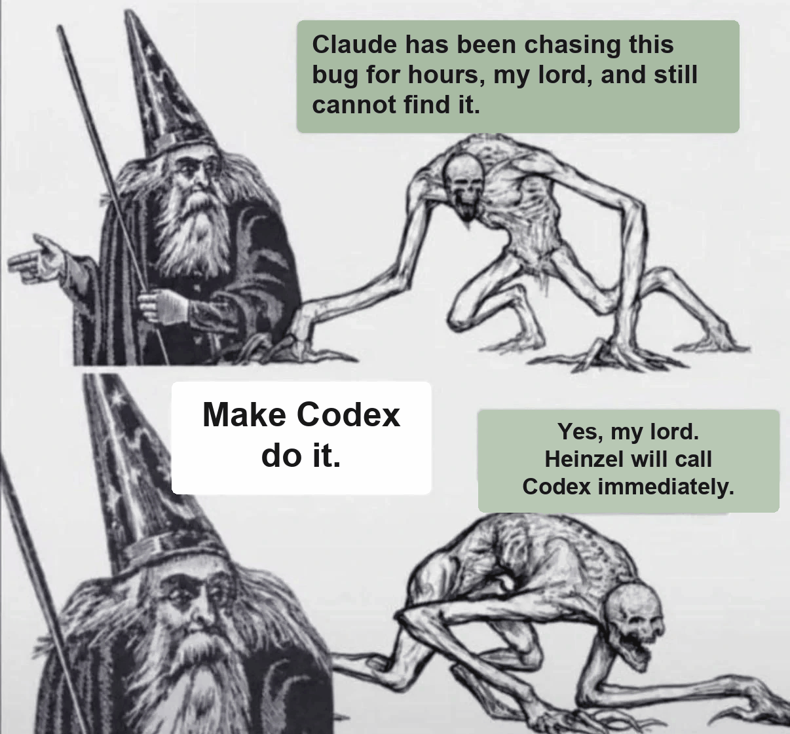

# Heinzel

Hand work from Claude Code to other coding agents, and get woken up when it's done. Codex first.

<p align="center">
  
</p>

> **Status: 0.1.0, built and tested on Claude Code 2.1.325 and Codex CLI 0.167.2.** It isn't published to a marketplace yet. Try it from a local checkout (below). Decisions are in [docs/adr](docs/adr/README.md); open questions in [docs/open-questions.md](docs/open-questions.md).

Named after the Heinzelmännchen of Cologne, house spirits who quietly finished people's work while they slept.

## What it does

- **Dispatch:** Claude sends a self-contained task to Codex and keeps working. There's no polling: when the task finishes, Claude is woken with the result.
- **Follow up or cancel:** Claude can send more instructions to the same Codex thread, or cancel a task it no longer needs.
- **Pick a model:** Claude can see which Codex models and reasoning efforts are available, and uses the one you ask for.
- **Isolate:** a task can run in its own git worktree, so parallel tasks don't collide.
- **Watch:** an optional panel lists every task and shows its full transcript, and a band above the input shows what's running.

Tasks run unattended. Codex's automatic review handles approvals, and a task never stops to ask you a question: if it gets stuck, it says why, and Claude takes it from there.

## Requirements

- Claude Code 2.1.325 or later
- Node.js 22.18 or later, on your `PATH` as `node`
- The Codex CLI, installed and signed in (`codex login`)

## Try it from a checkout

1. Get it and build it:

   ```bash
   git clone https://github.com/rnijhara/heinzel.git
   ```

   ```bash
   cd heinzel
   ```

   ```bash
   npm install
   ```

   ```bash
   npm run build
   ```

2. Start Claude Code with the plugin loaded from this folder:

   ```bash
   claude --plugin-dir /path/to/heinzel
   ```

3. Run `/heinzel-setup`. It checks Node and Codex and shows you the two settings below. It adds them to `~/.claude/settings.json` only if you say yes. Then restart Claude Code.

   ```json
   {
     "env": {
       "CLAUDE_CODE_MCP_AUTO_BACKGROUND_MS": "1000",
       "CLAUDE_AUTO_BACKGROUND_TASKS": "1"
     }
   }
   ```

   These make Claude Code move a dispatched task to the background after about a second. They apply to every MCP server, so any MCP call that takes longer than a second will also finish in the background. Without them, a dispatch makes Claude wait until the task is done, and the result tells Claude what to add. Once Claude Code turns on MCP tasks for your sessions, Heinzel uses them automatically, and you can remove these settings. [ADR 5](docs/adr/0005-background-execution-and-wake.md) explains why.

4. Ask for some work, for example: "Use Codex (gpt-6.1-sol, low effort) to add a `--verbose` flag to the CLI, in its own worktree." Open the panel with `/heinzel`.

To install it rather than load it per session, add this folder as a local marketplace from inside Claude Code. Run `npm run build` first, because the plugin runs from `dist/`.

```
/plugin marketplace add /path/to/heinzel
/plugin install heinzel@heinzel
```

## Tools

| Tool | What it does |
| --- | --- |
| `dispatch` | Start a task |
| `roster` | List agents and models |
| `status` | Check a task's state |
| `recall` | Cancel a task |
| `follow_up` | Continue a task's thread |
| `transcript` | Read a task's thread |

Stopping a dispatched task from Claude Code's task list (or with TaskStop) cancels the Codex turn too.

## Where things live

Heinzel keeps its files in `~/.heinzel`, or in `$HEINZEL_HOME` if you set it ([ADR 17](docs/adr/0017-runtime-layout-and-lifetimes.md)):

- **Tasks:** `~/.heinzel/codex-<id>/tasks.json` and `tasks/<task-id>.jsonl`. Finished tasks are kept for 7 days (`HEINZEL_RETENTION_DAYS` changes that).
- **Helper log:** `~/.heinzel/codex-<id>/helper.log`. The shared helper runs Codex for every session, and exits after 10 idle minutes (`HEINZEL_IDLE_MS` changes that).
- **Worktrees:** `~/.heinzel/worktrees/<repo>-<hash>/<task-id>`, on branches named `heinzel/…`. A worktree the task didn't change is removed. One it changed is left for you to merge or delete.

## Development

```bash
npm run check
```

That runs the type check, the Node tests and the protocol drift check. They're also available on their own:

- **`npm run typecheck`**
- **`npm test`:** unit tests against a fake `codex app-server`, plus relay and helper integration tests. No account and no tokens needed.
- **`npm run check:protocol`:** compares Codex's protocol schema with `protocol/codex/<version>/`. When a new Codex version comes out, `node scripts/check-protocol.ts --update` adds its folder.
- **`claude plugin validate .` and `claude plugin test .`:** check the display mod and run its tests.
- **`node test/live/live.ts [scenario…]`:** live end-to-end runs with real Claude Code and Codex. They spend tokens, so run them by hand. Run `npm run build` first.

The process for design decisions is in [AGENTS.md](AGENTS.md).

## Contributing

Issues and pull requests are welcome: see [CONTRIBUTING.md](CONTRIBUTING.md). To report a vulnerability, see [SECURITY.md](SECURITY.md).

## License

[MIT](LICENSE). The files under `protocol/` are generated by the Codex CLI ([details](protocol/README.md)). The meme at the top is a re-captioned copy of a widely shared image and isn't covered by the license.

Heinzel is an independent project. It isn't affiliated with or endorsed by Anthropic or OpenAI.
