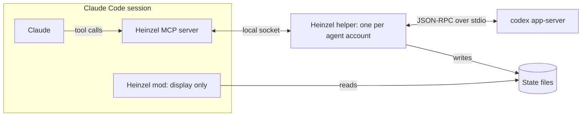

# ADR-0002: Plugin architecture: MCP server for logic, mod for display

- **Status:** Accepted
- **Date:** 2026-11-16

## Context

We want Claude, inside Claude Code, to hand work to another coding agent (Codex first), keep working, and be woken up when the work is done. Claude Code gives a plugin several building blocks:

- **MCP servers:** tools Claude can call, plus instructions that go into the system prompt.
- **Skills:** instructions loaded only when needed.
- **Hooks:** for example, adding context when a session starts.
- **Mods:** hooks modules that can draw panes and bands, register commands and tools, and run processes.

Facts that shaped the choice, checked on Claude Code 2.1.325:

- An MCP tool call can be moved to the background and wake Claude when it finishes. See ADR-0005.
- A mod can't hold a long-lived JSON-RPC connection with another process: `$.process.spawn` takes stdin as a single string and then closes it.
- A mod's `$.prompt.submit` runs only once the session is idle, so a mod can't wake Claude in the middle of a turn.
- A tool registered by a mod is served by the mod's own hook. That would put logic in the mod, and it's untested whether such tools are moved to the background.

## Decision

Heinzel is one Claude Code plugin with two parts:

1. **An MCP server that holds all the logic:** the tools (ADR-0006), the orchestration instructions (ADR-0007), task tracking and agent control. It talks to a shared helper process that runs the agents (ADR-0004).
2. **A display-only mod** that shows tasks and transcripts (ADR-0011). It reads state the helper writes (ADR-0012) and never changes it.

There is no skill. The tool descriptions and the server instructions carry everything Claude needs.

## Alternatives considered

- **A CLI run through background Bash, plus a skill and a session-start hook:** it wakes Claude with no settings changes, but it relies on Claude remembering `run_in_background`, needs shell quoting for long task briefs, returns results through an output file, and puts the rules in injected context instead of the system prompt.
- **Logic inside the mod:** it can't hold a connection to the agent, can't wake Claude mid-turn, and the plugin would stop working without the mod.
- **A skill alongside the tools:** it would only repeat what the tool descriptions and server instructions already say.

## Consequences

- The plugin works fully without the mod. You just can't see the tasks.
- Background behaviour depends on Claude Code settings until MCP tasks are generally available (ADR-0005).
- Tool descriptions and server instructions are part of the product and need the same care as code.

## History

- 2026-11-16: Accepted.
